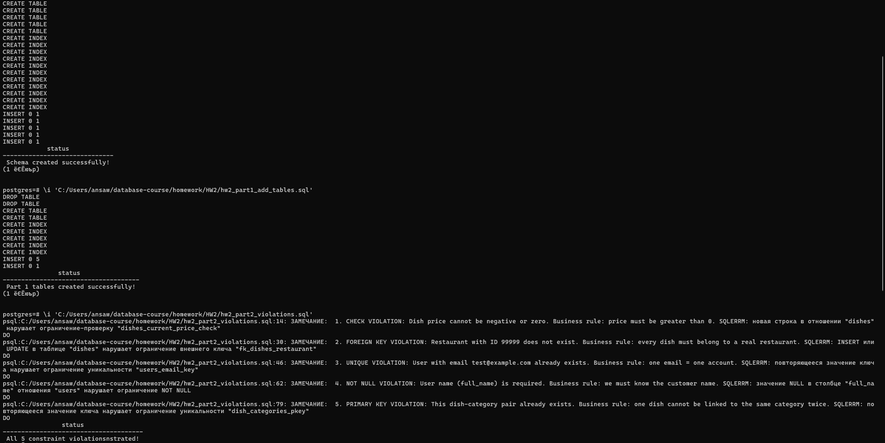

Документирование нарушений

| № | Ограничение | Выполняемый запрос (SQL) | Сообщение СУБД | Понятное сообщение для пользователя | Как исправить |
|---|-------------|-------------------------|----------------|-----------------------------------|---------------|
| 1 | CHECK | ```INSERT INTO dishes (restaurant_id, name, current_price) VALUES (1, 'Тест', -100.00);``` | `new row for relation "dishes" violates check constraint "dishes_current_price_check"` | «Цена блюда не может быть отрицательной. Укажите стоимость больше нуля» | Указать `current_price > 0`, например `500.00` |
| 2 | FOREIGN KEY | ```INSERT INTO dishes (restaurant_id, name, current_price) VALUES (99999, 'Блюдо', 500.00);``` | `insert or update on table "dishes" violates foreign key constraint "fk_dishes_restaurant"` | «Ресторана с таким ID не существует. Выберите существующий ресторан из справочника» | Сначала создать ресторан или использовать существующий `restaurant_id` |
| 3 | UNIQUE | ```INSERT INTO users (full_name, email, phone) VALUES ('Двойник', 'ivan@example.com', '+79991112233');``` | `duplicate key value violates unique constraint "users_email_key"` | «Пользователь с таким email уже зарегистрирован. Используйте другой email или восстановите доступ к существующему аккаунту» | Использовать уникальный email или выполнить восстановление пароля |
| 4 | NOT NULL | ```INSERT INTO users (full_name, email, phone) VALUES (NULL, 'noname@example.com', '+79990001122');``` | `null value in column "full_name" of relation "users" violates not-null constraint` | «Имя пользователя обязательно для заполнения. Укажите ФИО клиента» | Передать непустое значение: `full_name = 'Иван Иванов'` |
| 5 | PRIMARY KEY (составной) | ```INSERT INTO dish_categories (dish_id, category_id) VALUES (1, 1);``` | `duplicate key value violates unique constraint "dish_categories_pkey"` | «Это блюдо уже относится к данной категории. Повторная связь невозможна» | Проверить существующие связи или выбрать другую категорию |



Краткий вывод:
В ходе работы была создана физическая модель базы данных, для службы доставки еды, а также расширена и протестирована.
Результаты:
1. Реализованы связи M:N. Между блюдами и категориями, реализовано через `Dish_categories`. Использование составного ключа `(dish_id, category_id)` запрещает использование связей, а также настройка `ON DELETE CASCADE`, позволяет безопасно удалять зависимые записи без остатков.
2. Проверены ограничения целостности. С помощью 5 демонстраций доказано, что ограничения `CHECK`, `FOREIGN KEY`, `UNIQUE`, `NOT NULL` и `PRIMARY KEY` работают на уровне СУБД и защищают данные от некорректного ввода. Например, CHECK (current_price > 0) не даёт сохранить блюдо с отрицательной ценой, а UNIQUE на поле email запрещает регистрацию двух пользователей с одинаковым адресом.
3. Настроена обработка ошибок. С помощью блоков `DO $$ ... EXCEPTION ... END $$` технические ошибки PostgreSQL перехватываются и преобразуются в понятные бизнес-сообщения. Это важно для пользовательского опыта и упрощает отладку.
5. Добавлены индексы для производительности. Созданы индексы на все внешние ключи `(restaurant_id, user_id, courier_id, dish_id)`, а также составные и частичные индексы для частых запросов из ДЗ №1 (например, «топ-10 блюд за неделю», «выручка ресторана за месяц»). Это ускоряет выборку данных без полного сканирования таблиц.